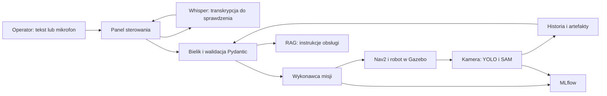

# RoboInspect AI

Robot inspekcyjny sterowany tekstem i głosem w symulowanym hangarze. Wydajesz polecenie po polsku, robot jedzie do wskazanego sektora, ogląda zdjęcia na tablicach i zapisuje wyniki. O to, co zobaczył i jak obsługiwać system, możesz zapytać lokalnego Bielika.

Projekt łączy robotykę, gotowe modele AI, przygotowanie danych, pilotażowy trening oraz wdrożenie z CI/CD. Działa lokalnie, bez płatnego API LLM. Stan dokumentacji: **21.10.2026**.

## Co potrafi

- **Nawigacja:** ROS 2, Gazebo, Nav2 i SLAM. Sektory A/B/C, baza, omijanie przeszkód, mapa i aktualna trasa.
- **Kokpit:** kamera robota 1280×720 z ramkami YOLO, kamera podążająca, monitoring z góry oraz mapy 2D.
- **Inspekcja:** robot odwiedza tablice P1 do P5, zatrzymuje się przed nimi, wykonuje analizę i wraca na pole sektora. YOLO11s wykrywa obiekty, SAM 2.1 Tiny wyznacza ich maski.
- **Asystent:** Bielik 4.5B Q4_K_M interpretuje polecenia. Pydantic sprawdza plan, a wykonawca przekazuje go do Nav2. RAG wyszukuje instrukcje obsługi i podaje źródła.
- **Głos:** lokalny Whisper small zamienia nagranie na tekst. Przed wysłaniem możesz poprawić transkrypcję.
- **Panel:** przyciski przejazdów, inspekcji i mapowania, losowanie przeszkód i zdjęć, historia misji oraz detekcji. Otwarcie panelu rozpoczyna nową rozmowę, archiwizując poprzednią.
- **Dane i uczenie:** zbieranie kadrów, przegląd etykiet, EDA, podział danych i pilotażowe porównanie ridge z ResNet18.
- **Eksperymenty i wdrożenie:** MLflow, Docker Compose, Kubernetes kind, Prometheus, GitHub Actions, obrazy GHCR i ręcznie uruchamiane CD z rollbackiem obrazów.

**Ważne:** bieżące inspekcje korzystają z gotowych YOLO i SAM. Własny klasyfikator stanu tablicy jest wytrenowany pilotażowo, ale nie jest podłączony do misji. Jego dalszy rozwój pozostaje odłożony.

## Jak to działa



W trybie Kubernetes panel/brama HTTP, MLflow i Prometheus działają w kontenerach. ROS, Gazebo, wykonawca misji i modele AI pozostają na komputerze. RTX obsługuje renderowanie oraz inferencję Bielika i modeli wizyjnych; CPU obsługuje fizykę, ROS, nawigację, Whisper i embeddingi RAG. To lokalny klaster jednowęzłowy.

## Instalacja na nowym komputerze

Sprawdzona platforma: **Ubuntu 24.04 x86_64, Python 3.12, ROS 2 Jazzy i Gazebo Harmonic**. Pełny profil GPU sprawdzono na RTX 4060 Laptop 8 GB. Potrzebne są sterownik NVIDIA, działająca sesja graficzna, internet do pobrania zależności i miejsce na modele oraz obrazy kontenerów. Inny sprzęt wymaga sprawdzenia.

1. Przygotuj system i ROS według [instrukcji instalacji](docs/install-and-run.md).
2. Pobierz repozytorium. Dla SSH skonfiguruj wcześniej klucz GitHub:

```bash
cd ~/Desktop
git clone git@github.com:Mikolaaj/roboinspect-ai.git
cd roboinspect-ai
```

Możesz też użyć adresu HTTPS: `https://github.com/Mikolaaj/roboinspect-ai.git`.

3. Przygotuj środowiska i modele, kolejno:

```bash
bash scripts/setup_project.sh
bash scripts/setup_bielik.sh
bash scripts/setup_whisper.sh
bash scripts/setup_rag.sh
bash scripts/setup_vision.sh
```

Ostatni skrypt przygotowuje YOLO, zdjęcia i SAM. Pobieranie może potrwać. Nie trzeba instalować osobno CUDA Toolkit; środowisko wizji pobiera biblioteki PyTorch CUDA, ale wymaga zgodnego sterownika NVIDIA. Duże pliki trafiają do ignorowanego katalogu `data/`.

4. Do trybu Kubernetes przygotuj Docker Engine z Compose oraz narzędzia klastra:

```bash
docker info
docker compose version
bash scripts/setup_kubernetes_tools.sh
```

Szczegóły instalacji, wymagań i diagnostyki są w [instrukcji](docs/install-and-run.md). Dane, modele i dotychczasowe eksperymenty z tego laptopa nie są częścią klonu repozytorium.

## Codzienny start i zatrzymanie

Na przygotowanym komputerze uruchom cały system jedną komendą:

```bash
cd ~/Desktop/roboinspect-ai
bash scripts/run_kubernetes.sh
```

Poczekaj na komunikat **Gotowe**, zielony status Nav2 i obrazy kamer. Otworzą się kokpit i sterowanie. Pierwszy start może potrwać kilka minut.

| Widok | Adres |
|---|---|
| Kokpit i kamery | http://127.0.0.1:8765/ |
| Sterowanie i czat | http://127.0.0.1:8765/control |
| MLflow | http://127.0.0.1:5001/ |
| Prometheus | http://127.0.0.1:9090/ |

Zatrzymanie: **Ctrl+C w terminalu startowym** albo w drugim terminalu:

```bash
cd ~/Desktop/roboinspect-ai
bash scripts/stop_kubernetes.sh
```

Następnie możesz ponownie wykonać `bash scripts/run_kubernetes.sh`. Zatrzymanie zachowuje dane i klaster. Zamknięcie karty przeglądarki nie zatrzymuje robota.

Alternatywne tryby, uruchamiane osobno:

| Tryb | Start | Zatrzymanie |
|---|---|---|
| Bez kontenerów | `bash scripts/run_cockpit.sh` | `bash scripts/stop_cockpit.sh` |
| Docker Compose | `bash scripts/run_compose.sh` | `bash scripts/stop_compose.sh` |
| Kubernetes | `bash scripts/run_kubernetes.sh` | `bash scripts/stop_kubernetes.sh` |

Przed zmianą trybu zatrzymaj poprzedni. Współdzielą porty i dane. Nie uruchamiaj obok drugiego Gazebo ani Nav2.

## Pierwsza inspekcja

1. W sterowaniu wybierz **Wykryj obrazy w sektorze A**. Robot odwiedzi P1 i P2, zapisze obserwacje i wróci na czerwone pole A.
2. W kokpicie obserwuj obraz z ramkami YOLO. Rozwiń historię detekcji i wybierz obserwację, żeby zobaczyć także maski SAM.
3. Zapytaj Bielika: „Co wykryłeś w sektorze A?”. Odpowiedź dotyczy zapisanych obserwacji, które mogą być starsze od obecnych zdjęć.
4. Wpisz „Wróć do bazy” i naciśnij Enter. Shift+Enter dodaje nową linię.
5. Mikrofon tworzy edytowalny tekst. Sprawdź go i dopiero wyślij. **STOP** zatrzymuje bieżące zadania; przycisk zatrzymania analizy przerywa generowanie odpowiedzi.

Mapowanie oraz ustawienia hali obsługujesz przyciskami panelu. Zmiany świata mogą odświeżyć symulację i przenieść robota do bazy. Szczegóły: [SLAM](docs/slam.md), [magazyn](docs/warehouse-controls.md), [inspekcja](docs/vision-inspection.md), [głos](docs/voice-and-inspection-zones.md).

W MLflow wybierz eksperyment, potem **Runs** i konkretne uruchomienie. Zobaczysz parametry, metryki i artefakty. Pusty ekran GenAI Traces nie oznacza braku zwykłych runów. Prometheus pokazuje gotowość i metryki usług, nie procent wykorzystania GPU.

## Dane i własny model

Sekcja **Dane do modelu usterek** służy do zbierania, przeglądu i zatwierdzania próbek oraz przeliczania EDA. Dostępny pilot zawiera 200 kadrów: 120 treningowych, 40 walidacyjnych i 40 testowych, z pięcioma syntetycznymi stanami tablic.

Porównano cechy obrazu z ridge i dostrajany ResNet18. Wynik testowy wyniósł odpowiednio 65% i 100% na 40 kadrach. Tak mały syntetyczny test nie potwierdza skuteczności na rzeczywistych usterkach. Model nie jest automatycznie wdrażany do robota. [Dane i przegląd](docs/dataset.md), [trening i ograniczenia](docs/classifier-training.md).

## Testy i diagnostyka

```bash
bash scripts/test_project.sh -q
bash scripts/doctor.sh
bash scripts/kubernetes_status.sh
```

Pierwsza komenda sprawdza Python, JavaScript i formatowanie, druga odczytuje stan środowiska, trzecia pokazuje pody, usługi i PVC. Testy jednostkowe nie zastępują próby przejazdu w Gazebo. Scenariusz odbioru: [demo](docs/demo.md).

Sprawdzenie 21.10.2026: **198 testów Python i 8 testów JavaScript przeszło**, Ruff i formatowanie poprawne. Odczyt działającego systemu potwierdził gotowość Nav2, RTX, MLflow i Prometheusa oraz trzy gotowe pody. W tym przeglądzie nie powtarzano przejazdów ani treningu. [Pełne podsumowanie i wymagania kursu](docs/project-audit.md).

| Problem | Co zrobić |
|---|---|
| „Kokpit już działa” lub zajęty port | Zatrzymaj właściwy tryb skryptem z tabeli i poczekaj na zakończenie. |
| Docker: permission denied | Po dodaniu konta do grupy `docker` uruchom `newgrp docker` lub zaloguj się ponownie. |
| Nieistniejący socket Docker Desktop | Dla systemowego Engine wybierz `docker context use default` i sprawdź `docker info`. |
| Brak gotowości lub obrazów | Poczekaj na start; sprawdź `artifacts/cockpit/`, `artifacts/kubernetes/` i [diagnostykę GPU](docs/gpu.md). |
| Model gotowy, ale niezaładowany | To normalne przed pierwszym użyciem. Pierwsza odpowiedź może być wolniejsza. |

## Repozytorium, dane i wydania

- `src/roboinspect/`: API, kontrakty, misje, historia, czat, RAG i przetwarzanie danych.
- `operator/web/`: interfejs; `operator/server.py`: połączenie z ROS.
- `robotics/`, `simulation/`, `maps/`: robot, światy, nawigacja i mapy.
- `scripts/`, `config/`: przygotowanie, start, diagnostyka i konfiguracja.
- `deployment/`, `.github/workflows/`: kontenery, Kubernetes, CI i CD.
- `tests/`, `docs/verification/`: testy i zapisane wyniki weryfikacji.
- `data/`, `artifacts/`: lokalne modele, bazy, zdjęcia, wyniki i logi, poza Git.

CI sprawdza aplikację i kontenery, a po poprawnym pushu na main publikuje obrazy GHCR z tagiem SHA. Ręczne CD aktualizuje lokalny klaster. Przeprowadzono udane wdrożenie z jednorazowego runnera, który zakończył działanie i wyrejestrował się. Następne CD wymaga ponownej rejestracji runnera; zwykły start aplikacji jej nie wymaga. [Wydania i rollback](docs/releases-and-cd.md), [potwierdzenie CD](docs/ghcr-cd-results.md).

Zachowuj `data/`, jeśli chcesz zachować historię i modele. Przed zmianą położenia repozytorium sprawdź migrację absolutnych adresów artefaktów MLflow. Sekrety i lokalne `.env` pozostają poza Git. Panel jest przeznaczony do użytku lokalnego. Źródła i licencje modeli oraz zdjęć: [informacje o komponentach](docs/third-party/vision.md).

## Co jeszcze zostało

Najważniejsze: sprawdzenie instalacji na drugim, czystym komputerze oraz przygotowanie nagrania prezentacji. Dalsze możliwości to integracja własnego klasyfikatora z inspekcją, większy niezależny zbiór i szersze strojenie modeli. Nie są obecnie uruchamiane automatycznie. [Pokrycie kursu](docs/course-coverage.md), [audyt projektu](docs/project-audit.md).
