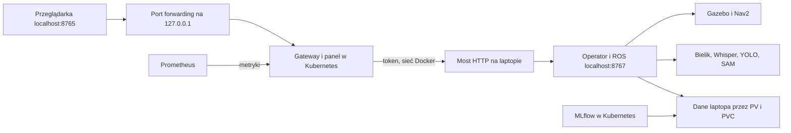

# Kubernetes lokalnie

Usługi HTTP, MLflow i Prometheus działają w klastrze kind. ROS 2, Gazebo, Nav2, SLAM, Bielik, Whisper, YOLO i SAM pozostają na laptopie. To wdrożenie demonstracyjne jednego węzła, bez wysokiej dostępności.

## Architektura



Most nasłuchuje wyłącznie na adresie interfejsu sieci Docker `kind`, port 18767. Wymaga losowego tokenu. Token jest przekazywany do poda jako Secret, nie znajduje się w repozytorium. API wykonawcy ROS pozostaje na 127.0.0.1:8767. Endpointy `/api/internal` są blokowane przez bramę.

Porty dostępne użytkownikowi są przekazywane na loopback: 8765 panel, 5001 MLflow, 9090 Prometheus. Kubernetes Services działają w sieci klastra; nie ma publicznego Ingress ani NodePort. Nie wystawiaj panelu sterującego bez uwierzytelniania do internetu.

## Pierwsze uruchomienie

Wymagania: przygotowane środowisko lokalnego projektu i działający systemowy Docker. Nie uruchamiaj Compose i Kubernetes jednocześnie, ponieważ współdzielą porty i dane MLflow.

```bash
cd ~/Desktop/roboinspect-ai
bash scripts/stop_compose.sh
bash scripts/setup_kubernetes_tools.sh
bash scripts/run_kubernetes.sh
```

Narzędzia kind 0.30.0 i kubectl 1.34.1 są pobierane do `data/deploy/bin` i weryfikowane sumą SHA256. Klaster korzysta z Kubernetes 1.34.0. Są to przypięte wersje demonstracyjne, nie deklaracja najnowszych wydań. Skrypt nie modyfikuje globalnego kubeconfig ani programów systemowych.

Pierwszy start pobiera obraz węzła, buduje lokalne obrazy aplikacji i ładuje je do kind. Poczekaj na komunikat Gotowe. Dwa okna aplikacji otworzą się automatycznie. Monitoring jest dostępny także z nagłówka panelu.

Zatrzymanie: Ctrl+C w terminalu startowym albo:

```bash
bash scripts/stop_kubernetes.sh
```

Podczas uruchamiania, zanim pojawi się Gotowe, zatrzymuj przez Ctrl+C w terminalu startowym. Skrypt zatrzymuje swoje procesy i skaluje usługi aplikacji do zera. Dane, definicje i klaster pozostają.

Powrót do Compose:

```bash
bash scripts/stop_kubernetes.sh
bash scripts/run_compose.sh
```

## Kontrola

```bash
export KUBECONFIG="$PWD/data/deploy/kubeconfig"
data/deploy/bin/kubectl --context kind-roboinspect -n roboinspect get pods,svc,pvc
data/deploy/bin/kubectl --context kind-roboinspect -n roboinspect logs deployment/gateway
```

Po gotowości sprawdź kamery, przejazd A, inspekcję i odpowiedź Bielika. Logi lokalnych procesów i port forwarding są w `artifacts/kubernetes/`. Logi symulacji nadal znajdują się w `artifacts/cockpit/`.

## Dane i ograniczenia

PV wskazuje istniejący katalog `data`, zamontowany na węźle kind pod tą samą absolutną ścieżką. PVC zachowuje bazę i artefakty MLflow. PV ma politykę Retain. Nie zmieniaj ścieżki projektu bez migracji adresów artefaktów. Nie uruchamiaj dwóch serwerów MLflow na tej samej bazie. Lokalni producenci logują do tej samej bazy SQLite jak dotychczas.

MLflow i gateway mają po jednej replice i strategię Recreate. Aktualizacja może chwilowo przerwać obraz i dostęp HTTP, dlatego zakończ przejazd przed wdrażaniem. Rollback obrazu nie odwraca migracji bazy. Przed zmianą wersji MLflow wykonaj backup SQLite przez jego backup API.

Dane pomiarowe Prometheusa w Kubernetes korzystają z emptyDir i znikają po odtworzeniu jego poda. Nie dotyczy to MLflow. Nie jest to wdrożenie wielowęzłowe ani chmurowe; hostPath i lokalny most wymagają tego laptopa.

## Automatyczny test klastra

```bash
.venv/bin/python scripts/check_kubernetes.py
```

Test używa osobnego namespace i tymczasowego katalogu danych. Sprawdza gotowość, HTTP, odtworzenie poda MLflow, metryki Prometheusa i powrót do poprzedniego obrazu po błędzie. Używa serwera testowego zamiast ROS, więc nie potwierdza nawigacji ani modeli GPU. Usuwa własny namespace, PV i dane po zakończeniu. Raport: `artifacts/kubernetes-check/result.json`.

Dokumentacja: [kind](https://kind.sigs.k8s.io/docs/user/quick-start/), [Kubernetes rollout](https://kubernetes.io/docs/concepts/workloads/controllers/deployment/#rolling-back-a-deployment).

## Weryfikacja 20.10.2026

Izolowany test klastra przeszedł: gotowość usług, panel HTTP, zachowanie runu MLflow po odtworzeniu poda, odczyt metryk przez Prometheusa oraz powrót do poprzedniego obrazu po celowo błędnym wdrożeniu. Wynik: [kubernetes-ci.json](verification/kubernetes-ci.json). Timeout podczas próby błędnego obrazu jest oczekiwanym elementem tego testu.

Sprawdzono również pełną sesję z lokalnym ROS i Gazebo na RTX 4060: trzy kamery, FPV 1280×720, zakończony przejazd A → BASE, odczyt gotowości wykonawcy i powrót połączenia po wymianie poda gateway. Raport: [kubernetes-live.json](verification/kubernetes-live.json). Pełne testy aplikacji: 197 testów Python oraz testy JavaScript zakończyły się sukcesem. Publikacja GHCR i ręczne CD nie są potwierdzone tym lokalnym testem.

## Aktualizacja 21.10.2026

Publikacja GHCR i rzeczywiste CD zostały później potwierdzone: [wyniki](ghcr-cd-results.md). Aktualny przegląd: 198 testów Python oraz 8 JavaScript poprawnych, działające trzy pody i gotowe usługi. [Zakres audytu](project-audit.md).
