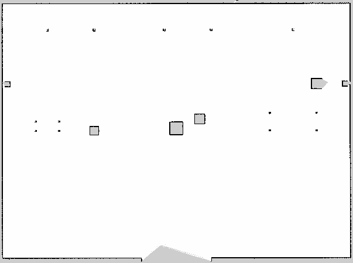

# SLAM — mapowanie hangaru i jazda na własnej mapie

Dwa oddzielne tryby:

- `--mode mapping`: Gazebo + kamery + SLAM Toolbox. Mapa powstaje z lidaru.
  AMCL i Nav2 nie są uruchomione; przyciski sektorów nie sterują w tym trybie.
- Domyślny `navigation`: AMCL lokalizuje robota na zapisanej mapie,
  a Nav2 wykonuje misje. SLAM jest wtedy wyłączony.

Pakiet systemowy: `sudo apt install ros-jazzy-slam-toolbox`.
Na obecnym komputerze był już zainstalowany. Pozostałe zależności i venv:
[install-and-run.md](install-and-run.md).

## Obsługa z panelu — dwie komendy (zalecane)

Powyższe skrypty CLI pozostają narzędziami diagnostycznymi. Standardowa obsługa
mapowania jest teraz w panelu, pod przyciskami A/B/C/BASE.

Najpierw zatrzymanie całego stosu:

```bash
cd ~/Desktop/roboinspect-ai
bash scripts/stop_cockpit.sh
```

Terminal 1:

```bash
cd ~/Desktop/roboinspect-ai
bash scripts/run_cockpit.sh
```

Terminal 2:

```bash
cd ~/Desktop/roboinspect-ai
bash scripts/run_control_panel.sh
```

Dalej używaj przycisków:

| Przycisk | Działanie |
|---|---|
| Rozpocznij mapowanie | Przełącza na świeży SLAM, ustawia robota w BASE i wykonuje obchód 8 punktów |
| Zapisz mapę | Zapisuje nową wersję mapy, podglądu, metadanych i grafu; robot musi być zatrzymany |
| Resetuj mapę | Przerywa obchód, zeruje bieżącą mapę i wraca do BASE w trybie SLAM; zachowuje zapisane mapy i historię |
| Zakończ mapowanie | Przerywa ewentualny obchód, zapisuje aktualną mapę i uruchamia AMCL + Nav2 na niej; symulacja startuje w BASE |

„Anuluj przejazd” zatrzymuje też aktywny obchód mapujący. Podczas operacji
nie można zlecać misji nawigacyjnych. Podczas obchodu zapis jest zablokowany;
można go przerwać resetem, zakończeniem lub anulowaniem. Przy przełączaniu
trybu kamery chwilowo oczekują na nową symulację; strona i API pozostają otwarte.

Turkusowa kropka na mapie jest aktualną pozycją robota, a grot pokazuje kierunek.
Pozycja pochodzi z TF `map → base_link`; rysowanie uwzględnia origin, obrót,
rozdzielczość i odwrócenie wierszy obrazu oraz przesunięcie `map_slam`.
Przy braku aktualnej pozycji kropka znika, zamiast pokazywać stary odczyt.
Mapa z robotem jest dostępna w kokpicie i panelu sterowania.

## Trwała historia operacji

Start, zapis, reset, zakończenie, postęp punktów, przerwanie i błędy są zapisywane
w tej samej bazie aplikacji co misje (`mapping_operations` w SQLite). Sekcja
„Historia przejazdów i mapowania” łączy oba typy wpisów. „Przebieg operacji”
rozwija szczegółowe zdarzenia z czasami. API: `GET /api/history` oraz
`POST /api/mapping/start|save|reset|finish`. Operacje przyjmują nagłówek
`Idempotency-Key`; ponowienie tego samego żądania nie powtarza przejazdu.

Operacje wykonuje pojedynczy nadzorca kokpitu; API zapisuje żądanie przed
uruchomieniem procesu. Przy zamknięciu/restarcie niedokończone operacje
otrzymują `interrupted` i nie są automatycznie ponawiane. Reset nie usuwa
historii ani plików zapisanych wersji. Wspólna blokada przyjmowania poleceń
wyklucza równoczesne misje i operacje SLAM.

Wersje map zapisują się w `data/maps/hangar_<id>.yaml` wraz z pozostałymi plikami.
Po udanym „Zakończ mapowanie” plik `data/current-map.json` zapamiętuje wybraną
mapę. Następny zwykły start kokpitu używa jej automatycznie dla tego samego
scenariusza. Jawne `--map` nadal nadpisuje wybór dla danego uruchomienia.
Duże lokalne grafy i baza nie trafiają do Git.

## Diagnostyka CLI (opcjonalna)

### Mapowanie i zapis z terminala

### 1. Najpierw zatrzymaj wszystko

```bash
cd ~/Desktop/roboinspect-ai
bash scripts/stop_cockpit.sh
```

Poczekaj na „Kokpit i symulacja zamknięte” lub „Brak aktywnego kokpitu”.
Nie usuwaj plików blokad podczas działania procesów.

### 2. Terminal pierwszy — mapowanie i trzy kamery

```bash
cd ~/Desktop/roboinspect-ai
bash scripts/run_cockpit.sh --mode mapping
```

Otwórz <http://127.0.0.1:8765/>. Poczekaj na „SLAM · mapowanie aktywne”.
Pod kamerami zobaczysz mapę: jasne = wolne, czarne = przeszkody,
szare = nieznane. Licznik aktualizacji/znanych komórek pochodzi z `/map`.

### 3. Terminal drugi — przejazd mapujący

```bash
cd ~/Desktop/roboinspect-ai
bash scripts/survey_hangar.sh
```

Robot rusza z BASE, objeżdża halę i wraca. Przejazd trwa kilka minut;
czekaj na komunikat „Obchód zakończony”. Nie wydawaj równolegle innych
komend ruchu. Ctrl+C w tym terminalu przerywa obchód i wysyła zatrzymanie.

To przygotowana trasa pomiarowa dla scenariusza `normal`, nie autonomiczna
eksploracja ani drugi planner. Sterowanie korzysta z pozycji SLAM, a lidar
zatrzymuje przejazd po wykryciu bliskiej przeszkody. Brak świeżej odometrii,
lidaru, zegara lub pozycji SLAM przerywa jazdę. Błąd nie uruchamia
samoczynnie ponownej próby. Po przerwaniu uruchom świeżą symulację od kroku 1.
Mapy są budowane z pomiarów, bez kopiowania syntetycznej mapy geometrii.

### 4. Zapis mapy — po zakończeniu obchodu

W drugim terminalu:

```bash
bash scripts/save_slam_map.sh --overwrite
```

`--overwrite` zastępuje poprzedni lokalny zapis o tej nazwie.
Możesz zachować osobny zapis: `bash scripts/save_slam_map.sh --name proba_2`.
Pliki w `data/maps/`:

- `hangar_slam.yaml` + `.pgm` — mapa do AMCL/Nav2.
- `hangar_slam.png` — podgląd do otwarcia jak zwykły obraz.
- `hangar_slam.json` — źródło, statystyki i uzgodnienie współrzędnych.
- `hangar_slam-native.posegraph` + `.data` — natywny graf SLAM i pomiary.

Lokalne pliki `data/` nie trafiają do Git. Zapis grafu służy do przyszłego
kontynuowania SLAM; uruchomienie ponownego mapowania na grafie nie jest
obecnie wystawione w launcherze.

### 5. Zatrzymanie mapowania

```bash
bash scripts/stop_cockpit.sh
```

Poczekaj na zakończenie, następnie w pierwszym terminalu:

```bash
bash scripts/run_cockpit.sh --map data/maps/hangar_slam.yaml
```

Teraz działa AMCL + Nav2 na mapie z lidaru. Poczekaj na „Nav2 gotowe”.
W drugim terminalu:

```bash
bash scripts/run_control_panel.sh
```

W panelu uruchom misję `A, B, C, BASE`. Sprawdź dojazdy, kamery,
anulowanie i zapis w historii. Nie uruchamiaj równocześnie mapowania.
Aby wrócić do mapy syntetycznej, zatrzymaj całość i uruchom zwykłe
`bash scripts/run_cockpit.sh` bez `--map`.

## Mapa referencyjna w repo

Zapis z udanego obchodu jest także w `maps/slam/hangar_slam.yaml` (+ PGM,
PNG i metadane). Możesz użyć go bez ponownego mapowania:

```bash
bash scripts/stop_cockpit.sh
bash scripts/run_cockpit.sh --map maps/slam/hangar_slam.yaml
```

Duży graf natywny pozostaje lokalnie w `data/maps/` i nie jest wysyłany do GitHub.
Raster referencyjny powstał z lidaru; nie jest generowany przez skrypt
`build_navigation_maps.py`.



Przy działającym kokpicie automatyczny odbiór (faktycznie porusza robotem):

```bash
/usr/bin/python3 scripts/check_cockpit.py --existing --goals A B C BASE --output-dir artifacts/slam-navigation
```

## Współrzędne i ograniczenia

Symulacja zaczyna w BASE `(-11, -7, 0)`, a odometria zaczyna w `(0,0,0)`.
SLAM pracuje w `map_slam`; stała transformacja `map → map_slam` dodaje
przesunięcie BASE. SLAM jest jedynym właścicielem `map_slam → odom`.
Podczas eksportu przesuwamy wyłącznie origin YAML o `(-11,-7)`, bez zmiany
komórek mapy. Natywny graf pozostaje w `map_slam`. Dlatego istniejące cele
sektorów mają ten sam układ współrzędnych po uruchomieniu AMCL.

To jawne wykorzystanie znanego punktu startowego i kierunku w symulacji.
Inny punkt/kierunek startowy wymaga ponownego uzgodnienia transformacji.
Nie uruchamiaj tej procedury na robocie fizycznym bez dostosowania sterowania.
Mapa pokazuje przekrój na wysokości lidaru; np. widoczne są nogi stołu,
a niekoniecznie jego blat. Nie oznacza to pełnej rekonstrukcji 3D.

Źródła techniczne:
[SLAM Toolbox](https://github.com/SteveMacenski/slam_toolbox/tree/jazzy),
[Nav2 i SLAM](https://docs.nav2.org/jazzy/tutorials/general_tutorials/navigation2_with_slam/navigation2_with_slam/).

Następny etap: [lokalny czat LLM na RTX](llm-local-plan.md).

Wyniki odbioru: [slam-results.md](slam-results.md).

Wyniki odbioru panelu: [mapping-panel-results.md](mapping-panel-results.md).
